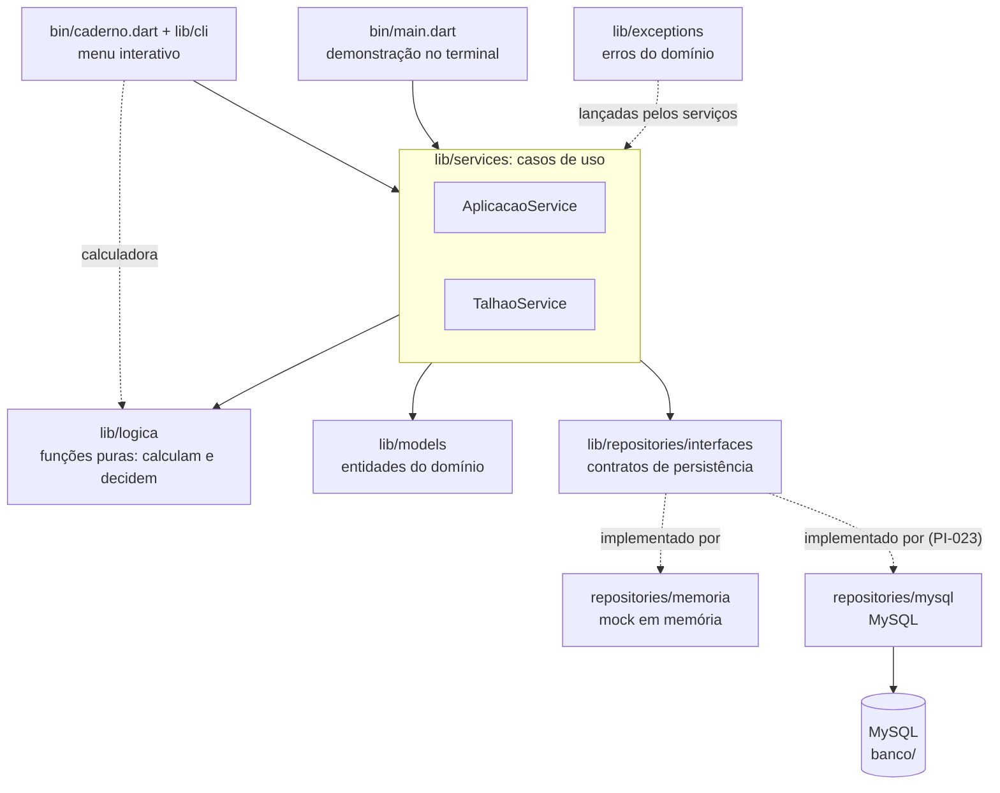

# Projeto Integrado · Modelagem e Desenvolvimento de Sistemas

Sistema de controle de insumos agrícolas desenvolvido para o Projeto Integrado do
2º semestre de 2026 — Ciência da Computação, UNIFEOB.

O objetivo é registrar o consumo de insumos por talhão e por aplicação, apontar onde a
propriedade gasta mais do que o previsto e transformar esse histórico em indicadores que
apoiem a decisão. O recorte se conecta ao **ODS 12 — Consumo e Produção Responsáveis**,
tema definido para este módulo.

---

## Visão geral do código

O **Caderno de Campo (AgroGestor)** é a parte em Dart do projeto. Roda no terminal e pode
guardar os dados **em memória** (padrão, sem banco) ou no **MySQL** (`--mysql`). Trocar uma
forma pela outra não muda nenhuma regra de negócio.

O que o código já faz:

1. **Cadastra** áreas, talhões, insumos, aplicadores (trator, drone, bomba costal) e operações.
2. **Registra uma aplicação.** Recebe as doses como estão na ficha de papel (mL/ha, g/ha,
   L/1000 L...), converte tudo para L/ha (líquido) ou kg/ha (sólido), calcula o volume de
   calda e quantas viagens o aplicador faz (a capacidade dele vale por viagem), aplica as
   regras da fazenda (chuva, sobredose) e calcula desperdício e quantidade a comprar.
3. **Totaliza o desperdício** de todas as aplicações, separando litros de quilos.
4. **Recusa dado inválido** com exceções próprias, e nada é gravado pela metade.

---

## Frentes de trabalho

O trabalho está dividido em quatro frentes, uma por unidade de estudo:

| Frente | Unidade de estudo | Integrantes | Onde fica |
|---|---|---|---|
| POO / Backend | Programação Orientada a Objetos | João Hélio, Cristiano | `lib/models`, `lib/services`, `lib/repositories`, `lib/exceptions` |
| Modelagem de Dados / DBA | Modelagem de Dados | Diogo | `banco/`, `docs/modelagem` |
| Lógica de Programação | Lógica de Programação (Dart) | Joaquim | `lib/logica`, `docs/fluxograma` |
| Business Intelligence | Business Intelligence | Bruno, Samuel | `bi/` |

O acompanhamento de tarefas é feito no **Caderno de Campo**, painel próprio da equipe:
https://apppi-ten.vercel.app

---

## Arquitetura em camadas



Quem conhece quem:

- **Os serviços** orquestram: buscam os dados pelas interfaces, chamam as funções de lógica,
  montam os objetos e só então gravam. Eles **só enxergam interfaces** de repositório, nunca
  o banco.
- **A lógica** (`lib/logica`) são funções puras: recebem números e **devolvem** o resultado
  (um enum, um número). Elas não lançam exceção de negócio, quem lança é o serviço.
- **Os models** guardam os dados e as próprias regras de consistência (campo obrigatório,
  valor positivo).
- **Os repositórios** escondem o banco. Trocar a memória pelo MySQL não toca em serviço,
  lógica nem model.

---

## Estrutura do repositório

```
.
├── bin/
│   ├── caderno.dart            menu interativo (memória; MySQL com --mysql)
│   ├── main.dart               demonstração no terminal (memória; MySQL com --mysql)
│   └── testar_conexao.dart     confere a conexão com o MySQL
├── lib/
│   ├── cli/                    o menu: conversa com o usuário, calculadora, dados de exemplo
│   ├── exceptions/             exceções próprias do domínio
│   ├── logica/                 funções puras: calculam e decidem
│   ├── models/                 entidades do domínio
│   ├── repositories/
│   │   ├── interfaces/         contratos de persistência (um por entidade)
│   │   ├── memoria/            implementação provisória, em memória
│   │   ├── mysql/              repositórios MySQL e a conexão (PI-023)
│   │   ├── configuracao_banco.dart   lê DB_HOST, DB_PORT... do ambiente
│   │   └── repositorios.dart   os seis repositórios montados (memória ou MySQL)
│   └── services/               casos de uso: juntam models, lógica e repositórios
├── test/                       espelha a estrutura de lib/
├── banco/                      SQL (reservado; ver banco/RESERVADO_PARA_SQL.md)
│   └── seeds/                  carga inicial
├── bi/                         Power BI
│   ├── queries/
│   └── documentacao/
├── docs/
│   ├── anuencia/               termo assinado pela propriedade + comprovante de CNPJ ativo
│   ├── requisitos/             levantamento feito junto ao produtor
│   ├── modelagem/              modelo conceitual, lógico e físico
│   ├── fluxograma/             percurso do dado, da entrada até o BI
│   ├── sprints/                relatórios de progresso
│   └── reunioes/               atas das reuniões da equipe
├── .env.example                nomes das variáveis de ambiente (sem valores)
├── dart_test.yaml              declara a tag `mysql`, dos testes que usam o banco
└── pubspec.yaml
```

---

## Papel de cada classe e módulo

### `lib/models/`: o domínio

| Arquivo | Papel |
|---|---|
| `entidade.dart` | `Entidade`: base abstrata de tudo que vira linha de tabela. Guarda o `id` (nulo até gravar) e a regra dele. |
| `validacoes.dart` | Funções de validação reaproveitadas pelos models: `textoObrigatorio`, `textoOpcional`, `positivoOuNulo`. |
| `area.dart` | `Area`: região da propriedade (ex.: Sede). |
| `talhao.dart` | `Talhao`: parcela de uma área, com `hectares` validado (maior que zero). O nome é único dentro da área. |
| `insumo.dart` | `Insumo`: produto aplicado, com nome, tipo e marca opcional. **Não** tem unidade de medida. |
| `operacao.dart` | `Operacao`: tipo de trabalho (ex.: pulverização). |
| `aplicador.dart` | `Aplicador`: classe **abstrata** do equipamento. Define `tipo`, `descreverCapacidade()` e `origemDoRegistro()`. |
| `trator.dart`, `drone.dart`, `bomba_costal.dart` | Subclasses de `Aplicador`. Cada uma responde do seu jeito (polimorfismo). |
| `aplicador_fabrica.dart` | `criarAplicador(tipo, ...)`: converte o texto do banco (`'drone'`) na subclasse certa. |
| `unidade_dose.dart` | Enum `UnidadeDose`: só `L/ha` ou `kg/ha`, as duas bases aceitas pelo banco. |
| `aplicacao_insumo.dart` | `AplicacaoInsumo`: classe de associação (insumo + unidade + dose prevista + dose realizada). |
| `motivo_reaplicacao.dart` | Enum `MotivoReaplicacao`: o imprevisto que obriga a refazer a aplicação (`chuva`, `sol`, `vento`, `outro`). É a categoria gravada no banco que o BI agrupa. |
| `aplicacao.dart` | `Aplicacao`: classe central. É **composta** por operação, aplicador, talhões e insumos. Guarda também as horas até a chuva e o motivo de reaplicação. |

### `lib/exceptions/`: os erros do domínio

| Arquivo | Quando é lançada |
|---|---|
| `agrogestor_exception.dart` | Base de todas as outras. Tem uma `mensagem` legível. |
| `dado_invalido_exception.dart` | Campo com valor inválido (informa o campo e o motivo). |
| `registro_nao_encontrado_exception.dart` | Id que não existe no repositório. |
| `talhao_invalido_exception.dart` | Hectares inválidos ou nome de talhão repetido na área. |
| `dose_invalida_exception.dart` | Dose prevista zero ou dose negativa. |
| `persistencia_exception.dart` | Falha de comunicação com o banco. Esconde o erro técnico. |
| `exclusao_negada_exception.dart` | Exclusão recusada porque o registro está em uso (diz o motivo e o que excluir antes). |

### `lib/logica/`: as regras (funções puras)

| Arquivo | Funções principais |
|---|---|
| `calculos_calda.dart` | `volumeCalda`, `quantidadeProdutoPorHa`, `quantidadeProdutoPor1000L`, `normalizarDose` (líquido, L/ha), `normalizarDoseMassa` (sólido, kg/ha), `converterUnidade`, `viagensNecessarias` (quantas viagens o aplicador faz) |
| `normalizacao_dose.dart` | `normalizarDoseInformada`: decide se a dose é líquida ou sólida e chama a função certa |
| `calculo_desperdicio.dart` | `desvioDose`, `percentualDesperdicio`, `quantidadeAComprar` (fator 0,95) |
| `alertas_operacionais.dart` | `avaliarChuva`, `avaliarCapacidade`, `avaliarSobredose`, com os enums de resultado |
| `totais_desperdicio.dart` | `totalizarPorUnidade`: soma previsto, realizado e desperdício por unidade (um mapa) |

### `lib/repositories/`: o acesso a dados

| Arquivo | Papel |
|---|---|
| `interfaces/repository.dart` | `Repository<T>`: contrato básico (`salvar`, `buscarPorId`, `listarTodos`, `remover`), tudo assíncrono. Traz também `exigirPorId`. |
| `interfaces/*_repository.dart` | Um contrato por entidade, com as buscas específicas (ex.: `TalhaoRepository.listarPorArea`). |
| `memoria/repositorios_memoria.dart` | Implementação **provisória**: guarda em memória, gera ids e imita a regra `UNIQUE` do talhão. Tem a chave `bancoIndisponivel` para simular o banco fora do ar. |
| `configuracao_banco.dart` | `ConfiguracaoBanco.doAmbiente()`: lê as variáveis de ambiente, confere e **nunca imprime a senha**. |
| `mysql/conexao_mysql.dart` | `ConexaoMysql`: abre a conexão com TLS (`global-bundle.pem`) e transforma qualquer falha do driver em `PersistenciaException`. |
| `mysql/ajuda_mysql.dart` | Conversões (texto do banco para `int`, `double` e data) e o `INSERT`/`UPDATE` comum a todos os repositórios. |
| `mysql/*_repository_mysql.dart` | Uma implementação MySQL por interface. `AplicacaoRepositoryMysql` grava a aplicação, os talhões e os insumos numa **transação**. |
| `repositorios.dart` | `Repositorios`: os seis repositórios montados, em memória (`Repositorios.memoria()`) ou no MySQL (`Repositorios.mysql(banco)`). É onde o programa escolhe de onde vêm os dados. |

### `lib/services/`: os casos de uso

| Arquivo | Papel |
|---|---|
| `aplicacao_service.dart` | `AplicacaoService.registrar(...)`: o fluxo principal. `resumoDesperdicio()`: totais de todas as aplicações. |
| `talhao_service.dart` | `TalhaoService`: cadastrar talhão (nome único na área), listar por área e corrigir nome e hectares. |
| `manutencao_service.dart` | `ManutencaoService`: corrige área, insumo, aplicador, operação e aplicação (data, observação, dose realizada) e exclui os seis tipos de registro. Recusa excluir o que está em uso. Vale igual na memória e no MySQL. |
| `parametros_operacionais.dart` | `ParametrosOperacionais`: tolerância de sobredose, limite da chuva e fator de compra, num lugar só. |
| `dose_informada.dart` | `DoseInformada`: a dose **como foi anotada** na ficha (valor + unidade), antes de converter. |
| `resultado_aplicacao.dart` | `ResultadoAplicacao` e `AvaliacaoInsumo`: o que o serviço calculou (volume, alerta de chuva, desperdício, status). |

### `lib/cli/`: o menu interativo

| Arquivo | Papel |
|---|---|
| `terminal.dart` | `Terminal`: a entrada e a saída de texto, como interface. `TerminalConsole` usa o teclado e a tela; os testes usam um terminal com respostas prontas. |
| `interacao.dart` | `Interacao`: as perguntas (texto, número, data, sim ou não), as listas de escolha e o laço do menu. Se a resposta não serve, pergunta de novo; se o sistema recusa a operação, mostra o erro e o menu continua. |
| `leitura.dart` | Transforma o que foi digitado em número (vírgula ou ponto), data (dia/mês/ano) e lista de ids. |
| `formato.dart` | Número com vírgula, data e os textos das decisões da lógica (chuva, sobredose, capacidade e viagens). |
| `menu_caderno.dart` | `MenuCaderno`: o menu principal. Cadastra pelos models e repositórios, registra aplicação pelo `AplicacaoService`, lista e resume. |
| `menu_calculadora.dart` | `MenuCalculadora`: uma opção para cada função de `lib/logica`, chamada direto, sem serviço nem banco. |
| `menu_manutencao.dart` | `MenuManutencao`: as opções Corrigir e Excluir. Pergunta, mostra o que vai mudar e pede a confirmação; as regras ficam no `ManutencaoService`. |
| `dados_exemplo.dart` | `garantirDadosExemplo`: cria, sem duplicar, os cadastros de exemplo da fazenda. A demonstração (`bin/main.dart`) usa o mesmo. |

### `test/`

Os testes ficam em `test/`, na mesma estrutura de pastas de `lib/` (models, exceptions,
logica, repositories, services e cli). `test/ajuda/erros.dart` tem os auxiliares que capturam a
mensagem de um erro, `test/ajuda/terminal_simulado.dart` é o terminal com respostas prontas
dos testes do menu, e `test/dados/dados_teste.dart` tem os dados de exemplo da equipe.

---

## Conceitos de POO aplicados

| Conceito | Onde aparece | Por quê |
|---|---|---|
| **Abstração** | `Aplicador` (classe abstrata) | O sistema fala de "aplicador" sem se importar com qual equipamento é. |
| **Herança** | `Trator`, `Drone`, `BombaCostal` herdam de `Aplicador`; todas as entidades herdam de `Entidade`; todas as exceções herdam de `AgroGestorException` | Reaproveita o que é comum (id, validação, mensagem). |
| **Polimorfismo** | `aplicador.descreverCapacidade()` e `aplicador.origemDoRegistro()` | O mesmo comando dá resposta diferente para cada tipo (o drone cita o app; trator e bomba, a ficha de papel). |
| **Encapsulamento** | Campos privados com `set` que valida: `Talhao.hectares`, `Insumo.nome`, `Aplicador.capacidadeMaximaL`... | O objeto nunca fica com dado inválido. Quem tenta recebe uma exceção. |
| **Composição** | `Aplicacao` tem `Operacao`, `Aplicador`, lista de `Talhao` e lista de `AplicacaoInsumo` | Uma aplicação é feita de partes que não existem sozinhas no contexto. |
| **Classe de associação** | `AplicacaoInsumo` | A relação N:N entre aplicação e insumo carrega dados próprios (a dose). |
| **Interfaces e inversão de dependência** | `abstract interface class Repository<T>` e uma por entidade | Os serviços dependem do contrato, não do banco. |
| **Fábrica** | `criarAplicador(tipo, ...)` | Transforma o texto do banco na subclasse certa. |
| **Enums tipados** | `UnidadeDose`, `DecisaoChuva`, `ResultadoCapacidade`, `StatusSobredose` | Resultado nunca é uma `String` solta. |
| **Exceções próprias** | `lib/exceptions/` | Cada tipo de erro tem nome e mensagem clara. |

---

## Lógica de programação aplicada

A orientação do PI pede variáveis, listas, mapas, funções, condicionais e repetição. Onde
cada uma aparece:

| Exigência | Onde |
|---|---|
| **Variáveis e constantes** | `limiteChuvaPadraoHoras` e `fatorCompraPadrao`; os `ParametrosOperacionais` |
| **Listas** | `Aplicacao.talhoes` e `Aplicacao.insumos`; `registrar(talhaoIds: [...], doses: [...])` |
| **Mapas** | `totalizarPorUnidade` devolve `Map<String, TotaisDesperdicio>` (a chave é `L/ha` ou `kg/ha`); `ConfiguracaoBanco.doAmbiente` lê um `Map` de variáveis |
| **Funções** | Todas as de `lib/logica`: recebem dados, devolvem resultado, sem efeito colateral |
| **Condicionais** | `if` e `switch` em `avaliarChuva`, `avaliarSobredose`, `normalizarDoseInformada`, `AplicacaoService._viagens` |
| **Repetição** | `for` em `AplicacaoService.registrar`, `_massaDeSolidos`, `totalizarPorUnidade` |
| **Tratamento de erros** | Funções de lógica devolvem enums; o serviço transforma o resultado em exceção do domínio |

### Regras de negócio

| Regra | Função | Resultado | Parâmetro | Pendência |
|---|---|---|---|---|
| **Chuva** | `avaliarChuva` | Menos de 3 h: reaplicar. Mais de 3 h: não reaplicar. | Limite de horas (padrão 3) | **PENDENTE:** a fazenda não definiu o caso de **exatamente 3 h**. Hoje: não reaplicar (`reaplicarNoLimite: true` inverte). |
| **Capacidade** | `avaliarCapacidade` e `viagensNecessarias` | A capacidade vale **por viagem** (voo do drone, enchida da bomba, carga do trator). Volume maior que ela não é erro: pede mais viagens (divisão arredondada para cima). Igual: 1 viagem. | Capacidade do aplicador, em L e em kg | A capacidade do trator ainda não foi levantada (nula: as viagens não são calculadas). **PENDENTE:** calda e sólidos têm as viagens calculadas separadamente; falta confirmar com a fazenda se vão juntos no mesmo voo. |
| **Sobredose** | `avaliarSobredose` | `ok` (até o previsto), `atencao` (até a tolerância), `critico` (acima) | Tolerância em % (obrigatória) | O valor da tolerância é do agrônomo. |
| **Desperdício** | `percentualDesperdicio` | (realizado − previsto) ÷ previsto × 100. Aplicar menos que o previsto dá 0. | | |
| **Fator de compra** | `quantidadeAComprar` | Quantidade calculada × 0,95 (a fazenda compra 5% a menos) | Fator (padrão 0,95) | |
| **Normalização** | `normalizarDoseInformada` | Líquido vira L/ha; sólido vira kg/ha. Litro e quilo nunca se misturam (sem densidade). | Taxa de aplicação (L/ha) | **PENDENTE:** `g/1000L` e `kg/1000L` ainda não são tratadas. |
| **Volume de calda** | `volumeCalda` | Área total × taxa | Taxa (L/ha) | Não é gravado no banco (decisão D1 em aberto): é sempre calculado. |

---

## Fluxo principal: registrar uma aplicação

`AplicacaoService.registrar` faz, nesta ordem (o desenho está em
[`docs/fluxograma/fluxo_dados.md`](docs/fluxograma/fluxo_dados.md)):

1. Confere a taxa de aplicação (maior que zero).
2. Busca operação, aplicador, talhões e insumos pelos ids.
3. Normaliza cada dose para L/ha (líquido) ou kg/ha (sólido).
4. Monta a `Aplicacao`, que garante as próprias regras.
5. Calcula o volume de calda (área × taxa) e a massa de produtos sólidos.
6. Calcula quantas **viagens** o aplicador faz para levar a calda e os sólidos. A capacidade
   vale por viagem, então uma aplicação maior que ela não é erro: é gravada inteira e o
   resultado diz quantas viagens são necessárias.
7. Aplica a regra da **chuva**, se as horas foram informadas. As horas e o motivo de
   reaplicação (chuva, sol, vento, outro) ficam **gravados** na aplicação. Se a chuva veio
   antes do limite e nenhum motivo foi informado, o motivo gravado é `chuva`.
8. Por insumo: quantidade prevista, quantidade a comprar, desperdício e status de sobredose.
9. Grava pelo repositório.

Se qualquer passo recusar, a exceção sobe e **nada é gravado**.

Saída esperada de `dart run bin/main.dart` (doses, taxa e tolerância são exemplos de
demonstração, não da fazenda):

```text
== Caderno de Campo - demonstração (dados em memória) ==

== 1. Cadastros ==
  nome:Chico1 - id:1 - hectares:2.8 - area:Sede
  nome:Chico2 - id:2 - hectares:3.8 - area:Sede
  Drone DJI: até 70 L / 70 kg por voo

== 2. Registro de uma aplicação (fluxo principal) ==
  Aplicação 1 em 06/11/2026
  Aplicador: Drone DJI: até 70 L / 70 kg por voo
  Registrado em: app do drone e ficha de papel
  Área total: 6,60 ha
  Volume de calda: 66,00 L
  Viagens da calda: 1 viagem (até 70 L por viagem)
  Massa de produtos sólidos: 3,30 kg
  Viagens dos sólidos: 1 viagem (até 70 kg por viagem)
  Chuva: choveu antes do limite: REAPLICAR
  - Orkestra SC
      dose prevista: 0,300 L/ha
      dose realizada: 0,345 L/ha
      quantidade prevista: 1,980 L
      quantidade a comprar (fator 0,95): 1,881 L
      desperdício: 15,0%
      sobredose: CRÍTICO (acima da tolerância)
  - Boro Super
      dose prevista: 0,500 kg/ha
      dose realizada: 0,450 kg/ha
      quantidade prevista: 3,300 kg
      quantidade a comprar (fator 0,95): 3,135 kg
      desperdício: 0,0%
      sobredose: ok

== 3. Resumo de desperdício (todas as aplicações gravadas) ==
  L/ha
    previsto: 1,980 L
    realizado: 2,277 L
    desperdício: 0,297 L
    percentual: 15,0%
  kg/ha
    previsto: 3,300 kg
    realizado: 2,970 kg
    desperdício: 0,000 kg
    percentual: 0,0%

== 4. Aplicação com mais de uma viagem (só calcula, não grava) ==
  Taxa de 20 L/ha: calda de 132,00 L
  Viagens da calda: 2 viagens (até 70 L por viagem)

== 5. Erros tratados (nada é gravado) ==
  taxa de aplicação zero -> Dado inválido: taxa (L/ha) (deve ser maior que zero)
  talhão com nome repetido -> Talhão inválido: chico1 (já existe nesta área)
  banco fora do ar -> Erro de persistência: salvar aplicação

Aplicações gravadas ao final: 1
```

---

## Como rodar

Requer Dart SDK 3.13 ou mais novo (conforme `pubspec.yaml`).

```bash
dart pub get                    # baixa as dependências
dart run bin/caderno.dart          # menu interativo, dados em memória
dart run bin/caderno.dart --mysql  # o mesmo menu, lendo e gravando no MySQL (veja abaixo)
dart run bin/main.dart             # demonstração no terminal, dados em memória
dart run bin/main.dart --mysql     # a mesma demonstração, gravando no MySQL
dart test                       # todos os testes (os de banco são pulados sem DB_HOST)
dart format .                   # formata o código
dart analyze --fatal-infos      # análise estática: o CI exige zero avisos
```

> Use `dart run bin/main.dart`. O `dart run` sozinho procura `bin/caderno_fazenda.dart`,
> que não existe.

O CI do GitHub (`.github/workflows/ci.yml`) roda `dart pub get`, `dart format
--output=none --set-exit-if-changed .`, `dart analyze --fatal-infos` e `dart test`.

A demonstração e o menu em memória **não precisam de banco nem de variáveis de ambiente**.

### Usando o menu

`dart run bin/caderno.dart` abre o menu. Digite o número da opção e Enter. Em qualquer
pergunta, Enter sem escrever nada cancela a operação (ou pula um campo opcional). Os números
aceitam vírgula ou ponto (`2,8`) e as datas são dia/mês/ano.

| Opção | O que faz |
|---|---|
| 1. Cadastros | Nova área, talhão, insumo, aplicador (trator, drone ou bomba costal) e operação. Para mudar ou apagar o que já existe, use as opções 8 e 9. |
| 2. Registrar aplicação | O fluxo principal, passo a passo. Pergunta as horas até a chuva e a lista de imprevistos (chuva, sol/calor, vento, outro). Mostra um resumo para conferir (já com o volume de calda, a massa de sólidos e as viagens do aplicador), grava pelo `AplicacaoService` e imprime o volume de calda, as viagens, as quantidades, o desperdício e os alertas de reaplicação e de sobredose. Se a aplicação for maior que a capacidade de uma viagem, não é erro: ela é gravada inteira e o resultado diz quantas viagens são necessárias. |
| 3. Consultas | Lista áreas e talhões, insumos, aplicadores, operações e aplicações (com o detalhe de cada uma). A lista marca com `REAPLICAR` as aplicações que pedem reaplicação, e o detalhe mostra os **ALERTAS** no topo. A opção "Aplicações a reaplicar (imprevistos)" lista só essas aplicações e conta quantas há por imprevisto. |
| 4. Resumo de desperdício | Totais previstos, realizados e desperdiçados, separados em litros e quilos. |
| 5. Calculadora | Uma opção para cada função de `lib/logica`: volume de calda, quantidade de produto, normalização e conversão de unidades, regras da chuva, da capacidade (com as viagens) e da sobredose, desperdício e quantidade a comprar. Mostra também a mensagem de erro de cada função. |
| 6. Parâmetros | Muda a tolerância de sobredose, o limite da chuva e o fator de compra. |
| 7. Carregar dados de exemplo | Cria, sem duplicar, a área Sede, os talhões Chico1 e Chico2, o drone DJI, a operação Pulverização e os insumos Orkestra SC e Boro Super. |
| 8. Corrigir um registro | Área (nome), talhão (nome e hectares), insumo (nome, tipo e marca), aplicador (modelo e capacidades), operação (descrição) e aplicação (data, observação e dose realizada, em mL/ha, L/ha, g/ha ou kg/ha). Enter mantém o valor atual, um traço (`-`) apaga um campo opcional, e nada é gravado antes de você confirmar. |
| 9. Excluir um registro | Área, talhão, insumo, aplicador, operação ou aplicação. O sistema **recusa** excluir o que está em uso (área com talhões; talhão, insumo, aplicador ou operação usados numa aplicação) e diz o que excluir antes. A confirmação começa em "não", e excluir não pode ser desfeito. |

Quem nunca usou: opção **7** e depois a **2**. Sem `--mysql`, tudo fica na memória e some ao
sair. Com `--mysql`, o que for cadastrado e registrado fica no banco compartilhado da equipe,
então avise o time ou use nomes de teste. Isso vale também para corrigir e excluir: com `--mysql`,
a opção 9 apaga do banco que o BI lê, e o menu avisa isso antes de pedir a confirmação.

### Rodando no MySQL

Com `--mysql`, a mesma demonstração grava no banco (MySQL 8.4 na AWS). Uma vez por
computador:

1. Copie `.env.example` para `.env` e preencha com os dados do banco (peça ao Diogo). A senha
   fica só no seu `.env`, que o Git ignora.
2. Baixe o certificado público da AWS na raiz do projeto (a conexão usa TLS; o arquivo
   também é ignorado pelo Git):

   ```bash
   curl -O https://truststore.pki.rds.amazonaws.com/global/global-bundle.pem
   ```

3. Peça para liberar o **seu IP público** no grupo de segurança do banco.
4. Exporte as variáveis no terminal, porque o programa não lê o `.env` sozinho:

   ```bash
   set -a; source .env; set +a    # bash/zsh. No PowerShell: $env:DB_HOST = '...' (uma por variável)
   ```

5. Confira a conexão com `dart run bin/testar_conexao.dart` e depois rode
   `dart run bin/main.dart --mysql` (demonstração) ou `dart run bin/caderno.dart --mysql`
   (menu).

Se der tempo esgotado, o seu IP não está liberado. Se der `Access denied`, confira usuário e
senha no `.env`.

A demonstração só cria o que ainda não existe (área, talhões, aplicador, operação e insumos)
e registra uma aplicação nova a cada execução, então pode ser repetida. Os triggers de
auditoria do banco registram as gravações em `historico_alteracoes`.

Os testes que falam com o banco de verdade têm a tag `mysql` e só rodam com as variáveis
`DB_*` exportadas (`dart test -t mysql`). Sem elas, como no CI, são pulados.

---

## Onde o SQL entra

O SQL vem da frente de Modelagem de Dados. O código está pronto para ele e já roda no
banco real:

1. **Contratos prontos.** `lib/repositories/interfaces/` define o que o banco precisa
   oferecer (`salvar`, `buscarPorId`, `listarTodos`, `remover` e buscas específicas).
2. **Mock no lugar do banco.** `lib/repositories/memoria/` implementa os mesmos contratos.
3. **Repositórios MySQL.** `lib/repositories/mysql/` tem as classes que implementam as
   mesmas interfaces (PI-023). Os serviços não mudam.
4. **Conexão por variáveis de ambiente.** O `.env.example` lista os nomes (`DB_HOST`,
   `DB_PORT`, `DB_NAME`, `DB_USER`, `DB_PASSWORD`) e `ConfiguracaoBanco.doAmbiente()` as
   lê. **Nenhuma senha fica no código** e o `.env` está no `.gitignore`.
5. **Reaplicação.** A tabela `aplicacao` precisa de duas colunas, `horas_ate_chuva` e
   `motivo_reaplicacao`, que o Power BI usa para contar as reaplicações por imprevisto. O
   `ALTER TABLE` está em `banco/RESERVADO_PARA_SQL.md` e precisa rodar **antes** de usar
   `--mysql` com esta versão.
6. **Pasta de SQL.** `banco/` receberá `schema.sql`, `roles.sql`, `seeds/` e
   `triggers.sql`. O banco da AWS já tem as tabelas e os triggers, mas esses arquivos
   ainda precisam ser versionados aqui.

O mapa entre tabelas, classes e repositórios, as regras que o repositório MySQL precisa
respeitar (como gravar a aplicação em **transação**) e os pontos de atenção para o DBA
estão em [`banco/RESERVADO_PARA_SQL.md`](banco/RESERVADO_PARA_SQL.md).

---

## Roteiro para explicar na apresentação

Um caminho de uns 5 minutos:

1. **O problema (30 s).** A fazenda anota tudo em papel e perde o controle do desperdício
   de insumos (ODS 12).
2. **A arquitetura (1 min).** Mostre o desenho em camadas. A ideia: a regra de negócio não
   conhece o banco, por isso dá para testar sem MySQL.
3. **POO (1,5 min).** Abra `lib/models/aplicador.dart` e as três subclasses
   (herança e polimorfismo). Mostre `Talhao.hectares` (encapsulamento) e `Aplicacao`
   (composição).
4. **Lógica (1,5 min).** Abra `lib/logica/alertas_operacionais.dart`. Destaque que as
   funções **devolvem um enum** e quem lança a exceção é o serviço. Mostre a regra das 3
   horas e o que está PENDENTE.
5. **Demonstração (1 min).** Rode `dart run bin/main.dart`. Aponte três coisas: a
   conversão de 300 mL/ha para 0,300 L/ha, o alerta REAPLICAR e as viagens do drone (132 L
   são 2 viagens de 70 L, sem erro). Se
   quiser mostrar ao vivo, use o menu (`dart run bin/caderno.dart`): opção 7 carrega os
   dados, opção 2 registra a aplicação e opção 5 mostra as funções de `lib/logica` uma a uma.
6. **O SQL (30 s).** Mostre `lib/repositories/interfaces/` e diga: "o MySQL só implementa
   estas interfaces".

Perguntas que podem aparecer:

- *Por que as funções de lógica não lançam exceção?* Decidir e reagir são responsabilidades
  diferentes. A função decide; o serviço escolhe se vira erro ou alerta.
- *Por que duas unidades (L/ha e kg/ha)?* Converter litro em quilo exige a densidade do
  produto, que a fazenda não tem. Em vez de chutar, o sistema recusa a conversão.
- *Por que o volume de calda não é gravado?* Ele não se decompõe por talhão nem por produto
  (decisão D1, em aberto), então é calculado quando precisa.
- *O que falta?* Veja a próxima seção.

---

## Pendências conhecidas

- **Chuva em exatamente 3 horas:** a fazenda não definiu. Hoje não reaplica.
- **Tolerância de sobredose:** quem define o valor é o agrônomo. A demonstração usa 10%
  só como exemplo.
- **Doses por 1000 L de calda para produto sólido** (`g/1000L`, `kg/1000L`): ainda não
  tratadas.
- **Capacidade do trator:** ainda não foi levantada (fica nula, e as viagens dele não são
  calculadas).
- **Calda e sólidos no mesmo voo:** as viagens de cada um são calculadas separadamente.
  Falta confirmar com a fazenda se os dois vão juntos no mesmo voo.
- **Nomes do banco:** a PI-012 manda `agrogestor` e chave `id`; os scripts de seed recebidos
  usam `caderno_fazenda` e `id_<tabela>`. O grupo precisa escolher um padrão. Hoje o
  repositório MySQL segue o do banco (`caderno_fazenda`, `id_<tabela>`); se o padrão mudar,
  só `lib/repositories/mysql/` precisa ser ajustado.
- **Scripts do banco no repositório:** o banco da AWS já tem as tabelas e os triggers
  (PI-012 e PI-018), mas `schema.sql`, `roles.sql`, seeds e `triggers.sql` (PI-012, PI-014,
  PI-017 e PI-018) ainda precisam ser versionados em `banco/`.
- **Entidades sem classe Dart:** compra, item de compra e histórico de alterações
  (o histórico é gerado por triggers).
- **Arquivos de modelo do `dart create`** (`bin/pi.dart`, `lib/pi.dart`, `test/pi_test.dart`)
  continuam no projeto e podem ser removidos pela equipe.

O detalhe de cada ponto está em `docs/sprints/2026-11-06-relatorio-branch-13.md`.

---

## Organização do time

Como todos trabalham no mesmo projeto Dart, vale combinar antes onde cada frente escreve.
A regra não é rígida — é para evitar duas pessoas editando o mesmo arquivo na mesma semana
e passar a tarde resolvendo conflito de merge.

### João Hélio e Cristiano · POO / Backend

```
lib/models/          entidades: Area, Talhao, Insumo, Operacao, Aplicador, Aplicacao
lib/services/        regras de negócio (casos de uso)
lib/repositories/    acesso a dados: interfaces, mock em memória e MySQL
lib/exceptions/      exceções próprias do domínio
test/                testes das regras
```

Sendo dois na mesma frente, dividam por entidade e não por camada — um pega Insumo de
ponta a ponta (model, service, repository), o outro pega Aplicador. Se dividirem por
camada, os dois esbarram no mesmo arquivo o tempo todo.

### Diogo · Modelagem de Dados / DBA

```
banco/schema.sql     estrutura das tabelas
banco/triggers.sql   auditoria e rastreabilidade
banco/seeds/         carga inicial com os dados da propriedade
docs/modelagem/      DER conceitual, lógico e físico
```

Você é o gargalo das duas primeiras semanas: POO e BI dependem do schema estar de pé.
Priorize fechar o modelo cedo. Depois disso, mudança de schema precisa ser avisada no
grupo antes de mergear — senão o pessoal dá pull e o código quebra sem motivo aparente.

### Joaquim · Lógica de Programação (Dart)

```
lib/logica/          algoritmos: chuva, capacidade, sobredose, desperdício e
                     normalização de dose
docs/fluxograma/     percurso do dado, da entrada até o BI
```

Sua pasta é separada da POO de propósito, para a unidade de Lógica ter território próprio
na hora da validação. Você vai consumir os models do pessoal de POO — combine a interface
com eles antes de começar, não depois.

### Bruno e Samuel · Business Intelligence

```
bi/agrogestor.pbix   o painel
bi/queries/          consultas usadas no Power Query
bi/documentacao/     KPIs escolhidos e justificativa
```

O `.pbix` é binário: **duas pessoas não podem editar ao mesmo tempo**, o Git não sabe
juntar. Combinem quem está com o arquivo, ou dividam em dois `.pbix` e juntem no fim.
E conectem no banco direto, não em CSV exportado — é o que prova a integração entre as
unidades, e é o que a banca vai testar.

### Todos

```
docs/sprints/        relatórios de progresso
docs/reunioes/       atas
README.md
```

---

## Modelo de dados

O banco é relacional. A escolha está justificada em `docs/modelagem`, junto do diagrama
entidade-relacionamento e da normalização aplicada.

Duas decisões que atravessam o projeto inteiro:

**Rastreabilidade.** Toda alteração relevante é registrada por trigger em uma tabela de
histórico, com autor e horário. Nada é sobrescrito silenciosamente.

**Integridade.** Chaves estrangeiras, restrições e tipos adequados são definidos no
banco, não apenas na aplicação. O banco é a última linha de defesa contra dado
inconsistente.

---

## Business Intelligence

O Power BI se conecta ao mesmo banco usado pela aplicação — não a arquivos exportados à
parte. É isso que garante que o painel reflete o sistema, e não uma cópia que envelhece.

Os indicadores acompanhados e as escolhas de modelagem estão documentados em
`bi/documentacao`.

---

## Convenções de trabalho

- Uma branch por tarefa; nada entra direto na `main`.
- Commits em português, seguindo Conventional Commits, com escopo quando fizer sentido
  (`feat(models): cria entidade base`, `fix:`, `docs:`).
- Toda mudança entra por Pull Request, com revisão de alguém de outra frente.
- Nunca use `git push --force`.
- Quem altera o schema avisa a equipe antes de mergear.
- Arquivos `.pbix` são binários e pesados: evite commits desnecessários.
- Senha e credenciais **nunca** vão para o repositório: use o `.env` (ignorado pelo Git).

---

## Beneficiário

O projeto é desenvolvido para uma propriedade rural com CNPJ ativo, mediante termo de
anuência assinado, arquivado em `docs/anuencia`.

O sistema não guarda dado pessoal de funcionário: não existe classe nem tabela de
funcionário (a decisão D5, sobre como identificá-los, segue em aberto). Dados comerciais e
pessoais de terceiros não são versionados em repositório público (decisão D8).

---

## Equipe

Bruno · Cristiano · Diogo · João Hélio · Joaquim · Samuel

Ciência da Computação · UNIFEOB · São João da Boa Vista, SP
2º semestre de 2026
