# Fluxograma do percurso do dado

| Campo | Conteúdo |
| --- | --- |
| **Autor** | João Hélio |
| **Data** | 06/11/2026 |
| **Requisito** | Lógica de Programação: fluxograma do percurso dos dados, da entrada até a visualização no BI, mostrando pontos de entrada e saída, decisões e etapas de tratamento (orientação do PI 2026-2; tarefa PI-022) |

Este documento mostra o caminho de um dado do Caderno de Campo: ele nasce na
ficha de papel ou no app do drone, passa pelas funções em Dart, é gravado no
MySQL e chega ao dashboard do Power BI. Cada etapa de Dart cita o arquivo e a
função que a executa. Os passos 1 a 9 do desenho são os mesmos passos
numerados em `AplicacaoService.registrar`
(`lib/services/aplicacao_service.dart`); o passo 10 é o método
`AplicacaoService.resumoDesperdicio`, do mesmo arquivo.

## Como ler o desenho

| Forma e cor | Significa |
| --- | --- |
| Paralelogramo verde | **ENTRADA** de informação |
| Paralelogramo azul | **SAÍDA** de informação |
| Losango amarelo | **DECISÃO** tomada pelo sistema |
| Retângulo cinza | etapa de **TRATAMENTO** do dado |
| Retângulo arredondado vermelho | **ERRO** tratado: a operação é recusada e nada é gravado |
| Cilindro roxo | **BANCO** de dados (MySQL) |

## Desenho

```mermaid
flowchart TD
    subgraph ENT["ENTRADA DOS DADOS (campo)"]
        FICHA[/"ENTRADA<br/>Ficha de papel<br/>data, talhões, insumos, doses, chuva"/]
        DRONE[/"ENTRADA<br/>App do drone<br/>registro do voo"/]
    end

    FICHA --> TRANSC
    DRONE --> TRANSC
    TRANSC["TRATAMENTO<br/>Transcrição para o sistema<br/>DoseInformada<br/>lib/services/dose_informada.dart"]

    subgraph DART["FUNÇÕES EM DART (lib/services e lib/logica)"]
        TAXA{"DECISÃO 1<br/>A taxa de aplicação é maior que zero?<br/>AplicacaoService.registrar<br/>lib/services/aplicacao_service.dart"}
        BUSCA["TRATAMENTO 2<br/>Buscar operação, aplicador, talhões e insumos<br/>exigirPorId<br/>lib/repositories/interfaces/repository.dart"]
        UNID{"DECISÃO 3<br/>Dose em qual unidade?<br/>Produto líquido ou sólido?<br/>normalizarDoseInformada<br/>lib/logica/normalizacao_dose.dart"}
        NLIQ["TRATAMENTO 3a<br/>Normalizar dose líquida para L/ha<br/>normalizarDose<br/>lib/logica/calculos_calda.dart"]
        NSOL["TRATAMENTO 3b<br/>Normalizar dose sólida para kg/ha<br/>normalizarDoseMassa<br/>lib/logica/calculos_calda.dart"]
        MONTA["TRATAMENTO 4<br/>Montar a aplicação<br/>Aplicacao<br/>lib/models/aplicacao.dart"]
        VOL["TRATAMENTO 5<br/>Calcular volume de calda e massa de sólidos<br/>volumeCalda e quantidadeProdutoPorHa<br/>lib/logica/calculos_calda.dart"]
        CAP["TRATAMENTO 6<br/>Calcular as viagens do aplicador (a capacidade vale por viagem)<br/>viagensNecessarias<br/>lib/logica/calculos_calda.dart"]
        CHUVA{"DECISÃO 7<br/>Choveu antes de 3 horas?<br/>avaliarChuva<br/>lib/logica/alertas_operacionais.dart"}
        REAP[/"SAÍDA<br/>Alerta: REAPLICAR"/]
        COMPRA["TRATAMENTO 8a<br/>Aplicar o fator de compra 0,95<br/>quantidadeAComprar<br/>lib/logica/calculo_desperdicio.dart"]
        DESV["TRATAMENTO 8b<br/>Calcular desvio e percentual de desperdício<br/>percentualDesperdicio e desvioDose<br/>lib/logica/calculo_desperdicio.dart"]
        SOBRE{"DECISÃO 8c<br/>A dose realizada passou da prevista?<br/>avaliarSobredose<br/>lib/logica/alertas_operacionais.dart"}
        STATUS[/"SAÍDA<br/>Status de sobredose:<br/>ok, atenção ou crítico"/]
        SALVA["TRATAMENTO 9<br/>Gravar a aplicação<br/>AplicacaoRepository.salvar<br/>lib/repositories/interfaces/aplicacao_repository.dart"]
        RESULT[/"SAÍDA<br/>Resultado da aplicação no terminal<br/>ResultadoAplicacao<br/>lib/services/resultado_aplicacao.dart"/]
        ERRO5(["ERRO TRATADO<br/>PersistenciaException<br/>lib/exceptions/"])
    end

    ERRO1(["ERRO TRATADO<br/>DadoInvalidoException<br/>taxa inválida, nada é gravado"])
    ERRO2(["ERRO TRATADO<br/>RegistroNaoEncontradoException<br/>nada é gravado"])
    ERRO3(["ERRO TRATADO<br/>DadoInvalidoException ou DoseInvalidaException<br/>nada é gravado"])

    TRANSC --> TAXA
    TAXA -->|"não"| ERRO1
    TAXA -->|"sim"| BUSCA
    BUSCA -->|"id não existe"| ERRO2
    BUSCA --> UNID
    UNID -->|"volume: L/ha, mL/ha, L/1000L"| NLIQ
    UNID -->|"massa: kg/ha, g/ha"| NSOL
    UNID -->|"unidade desconhecida ou dose negativa"| ERRO3
    NLIQ --> MONTA
    NSOL --> MONTA
    MONTA --> VOL
    VOL --> CAP
    CAP --> CHUVA
    CHUVA -->|"menos de 3 h"| REAP
    CHUVA -->|"3 h ou mais, ou sem chuva"| COMPRA
    REAP --> COMPRA
    COMPRA --> DESV
    DESV --> SOBRE
    SOBRE -->|"qualquer status"| STATUS
    SOBRE -->|"a sobredose não impede a gravação"| SALVA
    SALVA --> RESULT
    SALVA -->|"falha do banco"| ERRO5

    subgraph BANCO["BANCO DE DADOS (MySQL)"]
        MYSQL[("MySQL, usuário agrogestor_app<br/>aplicacao, aplicacao_talhao, aplicacao_insumo<br/>repositório MySQL: PI-023")]
        TRIG[("Trilha de histórico<br/>triggers gravam em historico_alteracoes<br/>PI-018")]
    end

    SALVA ==>|"transação"| MYSQL
    MYSQL --> TRIG

    RESUMO["TRATAMENTO 10<br/>Somar previsto, realizado e desperdício por unidade<br/>AplicacaoService.resumoDesperdicio e totalizarPorUnidade<br/>lib/logica/totais_desperdicio.dart"]
    RESUMOSAIDA[/"SAÍDA<br/>Resumo de desperdício em L/ha e kg/ha"/]
    MYSQL -.->|"leitura"| RESUMO
    RESUMO --> RESUMOSAIDA

    subgraph BI["BUSINESS INTELLIGENCE (Power BI)"]
        PBI["TRATAMENTO<br/>Power Query e modelo estrela<br/>usuário bi_leitura, modo Importar<br/>PI-019 e PI-021"]
        DASH[/"SAÍDA<br/>Dashboard AgroGestor<br/>KPIs de desperdício, PI-024"/]
    end

    MYSQL -->|"somente leitura"| PBI
    PBI --> DASH

    classDef entrada fill:#d4edda,stroke:#2e7d32,color:#111
    classDef saida fill:#cfe2ff,stroke:#1565c0,color:#111
    classDef decisao fill:#fff3cd,stroke:#b8860b,color:#111
    classDef tratamento fill:#f1f3f5,stroke:#555,color:#111
    classDef erro fill:#f8d7da,stroke:#c62828,color:#111
    classDef banco fill:#e7d6f5,stroke:#6a1b9a,color:#111

    class FICHA,DRONE entrada
    class REAP,STATUS,RESULT,RESUMOSAIDA,DASH saida
    class TAXA,UNID,CHUVA,SOBRE decisao
    class TRANSC,BUSCA,NLIQ,NSOL,MONTA,VOL,CAP,COMPRA,DESV,SALVA,RESUMO,PBI tratamento
    class ERRO1,ERRO2,ERRO3,ERRO5 erro
    class MYSQL,TRIG banco
```

## Justificativa de cada entrada e saída

| Ponto | Justificativa |
| --- | --- |
| **ENTRADA: ficha de papel** | É a fonte dos registros da fazenda hoje. As doses chegam em unidades variadas (mL/ha, g/ha, L/1000L), por isso precisam de tratamento antes de ir para o banco. |
| **ENTRADA: app do drone** | O drone registra o voo no próprio aplicativo, e a ficha de papel complementa. Isso aparece no código em `origemDoRegistro()` (`lib/models/drone.dart`). |
| **SAÍDA: alerta de reaplicação** | O operador precisa saber na hora que a chuva pode ter lavado o produto. O alerta fica no `ResultadoAplicacao`. As horas até a chuva e o motivo de reaplicação (chuva, sol, vento, outro) também ficam gravados na aplicação, para o alerta aparecer nas consultas e para o BI contar as reaplicações por imprevisto. |
| **SAÍDA: status de sobredose** | Mostra, por insumo, se a dose aplicada ficou dentro do previsto (`ok`), pouco acima (`atenção`) ou acima da tolerância (`crítico`). É um enum, nunca um texto solto. |
| **SAÍDA: resultado e resumo no terminal** | É a prova de que o fluxo funciona sem banco: `bin/main.dart` imprime os números calculados e o resumo de desperdício. |
| **SAÍDA: dashboard** | É o destino final do dado: o Power BI lê o MySQL e transforma as aplicações em indicadores de desperdício. |

## Justificativa de cada decisão

| Decisão | Justificativa |
| --- | --- |
| **1. A taxa é maior que zero?** | Sem taxa de aplicação (L/ha) não existe volume de calda nem conversão de dose por 1000 L. Recusar logo evita contas sem sentido nas etapas seguintes. |
| **3. Dose em qual unidade? Líquido ou sólido?** | A ficha traz unidades variadas e o banco só aceita `L/ha` e `kg/ha`. Litros e quilos nunca são convertidos entre si, porque isso exigiria a densidade do produto, que a fazenda não tem. |
| **7. Choveu antes de 3 horas?** | Regra da fazenda: chuva em menos de 3 horas depois da aplicação exige reaplicar. O limite é parâmetro (`limiteChuvaHoras`). **PENDENTE:** o caso de exatamente 3 horas não foi definido pela fazenda; hoje o sistema não manda reaplicar. |
| **8c. A dose realizada passou da prevista?** | Aplicar mais do que o previsto é sobredose. A tolerância (em %) é parâmetro obrigatório, porque quem define o valor aceitável é o agrônomo: até o previsto é `ok`, até a tolerância é `atenção`, acima dela é `crítico`. |

## Justificativa de cada etapa de tratamento

| Etapa | Justificativa |
| --- | --- |
| **Transcrição** | Uma pessoa copia a ficha para o sistema. A classe `DoseInformada` guarda a dose exatamente como foi anotada (valor e unidade), sem converter nada, para que a conversão fique em um só lugar. |
| **2. Buscar os registros** | O serviço recebe só ids. Buscar os objetos garante que cada id existe e traz os dados necessários: capacidade do aplicador, hectares do talhão e nome do insumo. |
| **3a e 3b. Normalizar a dose** | Converte tudo para a base do banco: mL/ha vira L/ha (divide por 1000), L/1000L vira L/ha (usa a taxa) e g/ha vira kg/ha. Assim todas as doses ficam comparáveis. |
| **4. Montar a aplicação** | A classe `Aplicacao` garante as próprias regras: ao menos um talhão e um insumo, sem repetição, data sem horário. A regra fica no objeto e não se espalha pelo código. |
| **5. Calcular volume e massa** | Volume de calda = área total x taxa. Ele não é gravado no banco (decisão D1 em aberto): é sempre calculado. A massa de sólidos soma as doses previstas (kg/ha) vezes a área. |
| **6. Calcular as viagens** | O tanque do aplicador tem um limite máximo POR VIAGEM (voo do drone, enchida da bomba, carga do trator). Passar dele não é erro: a aplicação só exige mais viagens. `viagensNecessarias` divide a quantidade pela capacidade e arredonda para cima; quantidade igual à capacidade é 1 viagem. Calda (em L) e sólidos (em kg) têm as viagens calculadas separadamente, e sem capacidade cadastrada (o trator) as viagens não são calculadas. |
| **8a. Fator de compra** | A fazenda compra 5% a menos do que o cálculo indica, ou seja, 95%. O fator é parâmetro (`fatorCompra`), para a regra não ficar escondida dentro da conta. |
| **8b. Desvio e percentual de desperdício** | O desvio é a dose realizada menos a prevista. O percentual divide o desvio pela dose prevista; aplicar menos do que o previsto não é desperdício e dá 0, nunca valor negativo. |
| **9. Gravar** | `AplicacaoRepository.salvar` é a única porta de saída para o banco. Hoje grava em memória; o repositório MySQL (PI-023) grava as três tabelas da aplicação numa transação. |
| **10. Resumo de desperdício** | Soma previsto, realizado e desperdício de todas as aplicações gravadas, separando litros de quilos. É o equivalente em Dart das medidas do BI (Total Previsto, Total Realizado, Volume Desperdiçado e percentual). |
| **Power Query e modelo estrela (BI)** | O BI lê o MySQL, nunca um arquivo solto, com um usuário que só consulta. Na tabela fato, a granularidade precisa ser escolhida com cuidado: a relação aplicação x talhão é N:N e a escolha errada duplica números. |
| **Trilha de histórico (triggers)** | Cada inclusão, alteração ou exclusão nas tabelas auditadas (`aplicacao`, `aplicacao_insumo`, `aplicacao_talhao` e `insumo`) grava uma linha em `historico_alteracoes`, que ninguém pode editar. Assim dá para saber quem mudou uma dose depois. |

## Exemplo percorrendo o fluxo

Dados de demonstração de `bin/main.dart` (valores ilustrativos, não da fazenda):
dois talhões somando 6,6 ha, taxa de 10 L/ha, drone com capacidade de 70 L.

| Etapa | O que acontece |
| --- | --- |
| Entrada | Orkestra SC: previsto 300 mL/ha, realizado 345 mL/ha. Boro Super: previsto 500 g/ha, realizado 450 g/ha. Chuva depois de 2,5 h. |
| Decisão 3 | Orkestra é volume (mL/ha); Boro é massa (g/ha). |
| Tratamento 3 | Orkestra: 0,300 e 0,345 L/ha. Boro: 0,500 e 0,450 kg/ha. |
| Tratamento 5 | Volume de calda: 6,6 ha x 10 L/ha = 66 L. Massa de sólidos: 3,3 kg. |
| Tratamento 6 | 66 L cabem em uma viagem do drone (70 L por voo): 1 viagem. Com taxa de 20 L/ha seriam 132 L, ou seja, 2 viagens: o sistema grava do mesmo jeito e informa as viagens. |
| Decisão 7 | 2,5 h é menos que 3 h: **REAPLICAR**. |
| Tratamento 8 | Orkestra: a comprar 1,881 L (95% de 1,980 L) e desperdício de 15,0%. Boro: desperdício de 0,0%. |
| Decisão 8c | Orkestra passou 15% do previsto, acima da tolerância de 10% do exemplo: **crítico**. Boro: `ok`. |
| Tratamento 9 | A aplicação é gravada. Com o banco fora do ar, o sistema lança `PersistenciaException`. |

## O que ainda depende de outras frentes

- A parte de **banco** e de **BI** do desenho segue as tarefas PI-012, PI-014,
  PI-018, PI-019, PI-021, PI-023 e PI-024. Os documentos que a descrevem
  (`banco/README.md` e `bi/documentacao/modelo_dimensional.md`) ainda não estão
  neste repositório. **Quando entrarem na `main`, revisar esta página**: nomes de
  tabela, usuário, modo de conexão e granularidade da tabela fato podem mudar.
- Todas as etapas de Dart do desenho existem e têm testes em `test/`. O
  repositório MySQL ainda não existe: hoje o dado para na etapa 9, em memória.
  Veja `banco/RESERVADO_PARA_SQL.md`.
- O desenho de normalização por tipo de produto está detalhado em
  `docs/fluxograma/base_normalizacao.md`.
